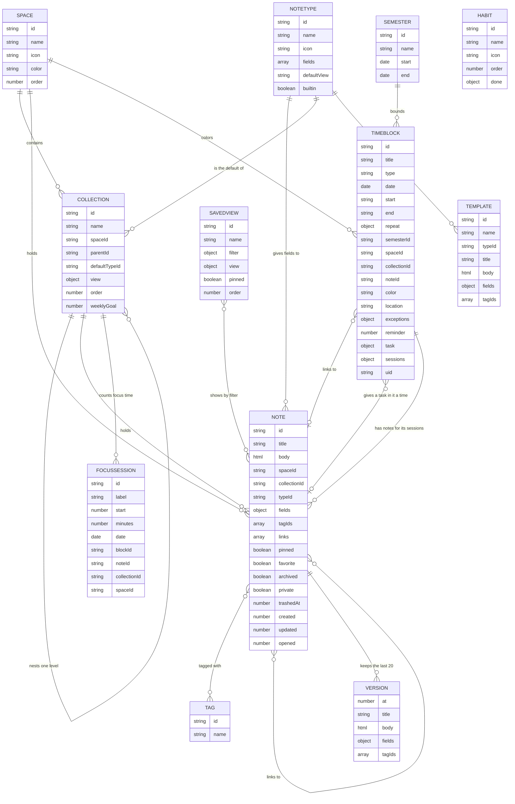

# Notes

A private notes app for one person. It holds any kind of note, stays organized over thousands of them, and keeps everything in your own browser. There is no server, no account and no tracking, and it works offline.

It's a static site: plain HTML, CSS and JavaScript modules, with no build step.

The one exception to "no server" is optional: you can connect your own Google Calendar. See [Where your data lives](#where-your-data-lives).

## Run it on your computer

Browsers block JavaScript modules on pages opened directly from a file, so it needs a small local server:

```bash
cd notes-app
python3 -m http.server 8000
```

Then open <http://localhost:8000>.

## Publish it on GitHub Pages

1. Create a repository on GitHub and push this folder to it, with `index.html` at the top level.
2. In the repository, open **Settings → Pages**.
3. Under **Build and deployment**, choose **Deploy from a branch**, then your branch (usually `main`) and the `/ (root)` folder. Save.
4. After a minute or so, the app is at `https://YOUR-USERNAME.github.io/YOUR-REPOSITORY/`.

No build or configuration is needed. All paths are relative, so it works from any folder.

**Your notes won't move by themselves.** Browsers keep data separately for each address, so notes made at `localhost` don't appear on your GitHub Pages address. To bring them across: at the old address, go to **Settings → Download backup**. At the new one, use **Settings → Import backup**.

Publishing the app does not publish your notes. They stay in your browser and are never uploaded. A public repository only makes the app's code public.

### Publishing an update

Push your changes. Open copies of the app check for a new version in the background and offer a **Reload** button. There is no version number to bump. If you add a new file to the app, also add it to the `FILES` list in `sw.js`, or it won't be available offline. `tests.html` checks that every listed file exists.

## Dashboard

The app opens on the dashboard (or on the Inbox or your last note: **Settings → Open the app on**). It greets you, has quick capture, and shows widgets in two columns on a wide screen and one on a phone, in the same order:

- **Your day:** everything for today in one list, in time order: timetable blocks, tasks with and without a time, deadlines and Google Calendar events, with what's on now and next marked. Tasks can be ticked here.
- **Your week:** Monday to Sunday at a glance, each day with what it holds, and totals for the week: hours on the timetable, tasks done, deadlines, habits and journal days. On a phone it's a strip of days with counts.
- Then journal check-in and Inbox.
- **Wins this week:** what you got done so far this week: tasks done, focus time, applications sent, journal days, habit check-ins and notes written. Only what happened shows.
- Then course review, habits, continue, pinned notes, "Bored? Try this", tonight's watch, on this day, and tidy-up and backup reminders.

Today's tasks, Schedule, Next 7 days and Weekly progress are also available in **Edit dashboard**. They start switched off, because Your day and Your week cover them. A widget with nothing to show shrinks to an "All clear" line or hides.

**Edit dashboard** lets you drag widgets into a new order (or use the arrows), make one wide, hide it, and set options, such as which list feeds Today's tasks or "Bored?". Journal entries never appear unless you allow them in **On this day**, and then only their titles.

- **Journal check-in:** one tap sets today's mood or energy, starting today's entry if needed.
- **Habits:** daily habits you define, ticked from the dashboard, with a streak and the last seven days.
- **Course review:** flashcards use spaced repetition. A card you get right comes back after 1, 3, 7, 14, then 30 days, and one you miss comes back tomorrow. New cards are due straight away. **Exam prep** has the same **Review** button.

## Staying motivated

- **Celebrations:** reaching a milestone shows a short card with a little confetti. Milestones: a journal streak (3, 7, 14, 30 days and on), a habit streak (7, 21, 30 days and on), everything due done after finishing 3 or more tasks in a day, a weekly goal reached, your first and 5th, 10th… application sent, and hours of focus adding up. Each one is celebrated once, on the device where it happened. No confetti when your device asks for reduced motion. Turn it all off in **Settings → Appearance**.
- **Weekly goals:** job and PhD application boards have a bar above them, such as **Sent this week: 2 of 3**. Choose **Set a weekly goal**. An application counts in the week its status changed to Applied (or Submitted for a PhD).
- **Focus timer:** start a focus session from a timetable block (**Start focus**), a note (**⋯ → Start a focus session**) or the command palette. Pick 25, 50 or 90 minutes, or your own. A small timer sits at the bottom of the screen with pause and stop, and keeps going if you reload. When it ends you hear a soft chime, and the time is logged to the block's or note's course and space. Stopping early logs the minutes so far. Your focus time shows in **Statistics**, on the dashboard and on space covers, and syncs between devices.
- **Space covers:** each space page opens with a cover in the space's colour, its emoji, and a line with its collections, notes and focus time this week.

## Timetable

**Timetable** in the sidebar (`G` then `C`) has a week grid, a single day, a month and an agenda list. On a phone it opens on today, and swiping sideways changes the day (or the month).

- **Month:** each day lists its blocks, tasks with a time and Google events in time order, with **+ more** when there are over four. Click a date, or **+ more**, to open that day. On a phone the items are coloured dots. Blocks are dragged in the week and day views, not here.

- **Adding:** type a line like `German Tue 18:15-20:00` and press Enter, click an empty spot in the grid, or use **New block**. Typed lines are shown in the editor first, so you can check them.
- **Repeating:** pick weekdays, every week, every 2 weeks, or odd or even weeks. A semester stops its blocks on its last day (**Hours and semesters**).
- **One week only:** opening a repeating block asks whether to change only that occurrence or all of them. One occurrence can also be cancelled and brought back.
- **Overlaps:** the editor warns about them before you save, and the grid shows them side by side, marked in words.
- **Dragging (mouse or pen):** draw a block on an empty part of a day, drag a block to move it, or drag its bottom edge to change its end. Times snap to 15 minutes, and Esc puts it back. On a touch screen a finger scrolls the grid, so blocks are changed in their editor there.
- **Tasks with a time:** a task with a date and a time, such as `15:00 project meeting` typed on Today, shows on the timetable by itself, half an hour long and with rounder corners. It's the task itself, not a copy: ticking it or dragging it to another time changes the task everywhere. Its text opens its note.
- **Tasks without a time:** **Tasks** opens a list of the open ones. Drag one onto a day, or use **Schedule**. The block keeps the task's checkbox, and **Unschedule** puts it back in the list. Ticking it on either side ticks it on both.
- **Google Calendar:** when it's connected, your Google events show on the timetable, outlined, with all-day ones under the day's name. Clicking one opens it in Google Calendar. Your timetable goes the other way: see [Connect Google Calendar](#connect-google-calendar).
- **Notes for a session:** a block's editor has **Write the lecture note** for classes and study sessions, which makes a course note with the date and lecture number, and **Write a note for this session** for anything else. The note links back to its session.
- **Reminders:** choose one in a block's editor. They show while the app is open in a tab, as a notification if you allow it. A static site has no server, so it can't remind you while it's closed.
- **More (⋯):** **Find free time**, **Print this week**, **Export as .ics**, and **Import an .ics file**, which shows what's in the file and lets you choose before anything is added. Calendar files use local times, and odd or even weeks are written out week by week, because calendar apps can't express them.
- **Keyboard:** Tab to a block, use the arrow keys to move between blocks, and press Enter to open one.

## Application trackers

Two built-in note types track applications: **Job application** and **PhD application**. A new setup has a collection of each under **Career**. To add one yourself, make a new collection in any space and choose the type: the name fills itself in.

- **A board by status:** the collection opens as a Kanban board. Jobs go Interested, Preparing, Applied, Interviewing, Offer, Rejected, Withdrawn. PhDs go Researching, Contacted supervisor, Preparing, Submitted, Interview, Offer, Rejected, Withdrawn. Drag a card's grip, use its menu, or press Alt and an arrow key to move it. **Table**, **Calendar** and **Timeline** show the same applications in other ways.
- **Fields:** jobs have company, deadline, next interview, location, work mode, salary, the job posting, where you found it, a contact, the date you applied and how much you want it. PhDs have university, deadline, interview, supervisor, research group, country, funding, stipend, start date, the programme page, when you contacted the supervisor, when you submitted and how much you want it. Each has room for free notes too.
- **A checklist to start with:** a job starts with Tailor CV, Write cover letter and Send application. A PhD starts with CV, Research proposal, Motivation letter, two reference letters, Transcripts and certificates, and Language certificate. Change them as you like.
- **Deadlines on Today:** the deadline shows on Today and the dashboard as "Apply: Data analyst · Spotify" until you've applied, and the interview date as "Interview: …" while you're waiting for it or in the interviews. After that they leave on their own, and a missed deadline isn't shown in red any more.
- **Dates fill themselves in:** moving a job to Applied sets **Applied on** to today, and moving a PhD to Submitted sets **Submitted on**, unless they already have a date.
- **Your own version:** in **Settings → Note types and custom fields**, **Duplicate to customize** makes a copy you can add fields to or change. The copy keeps the deadlines, the dates that fill in and the starting checklist.

## Colours

The theme is called "Peach and sage": a cream and white base, with coral for the main buttons, progress bars, the open item in the sidebar and a few highlights. Every colour is a variable in [css/theme.css](css/theme.css), once for light and once for dark.

- **Light, dark or auto:** choose in **Settings → Appearance**. Auto follows your device.
- **Space colours:** each space has a colour, which marks its notes, tags, timetable blocks and dashboard items. Pick one of twelve warm pastels with **Edit space** in the space’s ⋯ menu in the sidebar. School, Personal, Fun and Career start as sage, coral, honey and sky.
- **Readable:** all text meets WCAG AA (4.5:1) in both themes. Coral, red, green and amber are too light for text on cream, so text uses darker shades of them. Colour never shows a state on its own; an icon or a word goes with it.
- **Motion:** colours change with a soft 0.2 s fade, which turns off when your device asks for reduced motion.

## Where your data lives

- Everything is stored in this browser on this device, in IndexedDB. If that's blocked, it falls back to localStorage, and as a last resort to memory, with a warning.
- There is no copy anywhere else. Clearing your browser data or losing the device loses your notes unless you have a backup. The app reminds you after 14 days without one.
- **Backups:** Settings has a JSON backup of everything, including images and version history, which can be imported again. Markdown exports (a note, a collection, or everything as a zip) are for reading elsewhere.
- **Passcode lock (optional):** encrypts everything stored on the device with AES-GCM, using a key protected by your passcode (PBKDF2 with SHA-256, 600,000 rounds). **A forgotten passcode cannot be recovered.** Backup files are not encrypted, so keep them somewhere safe. The lock protects what's stored on the device, for instance from someone reading the browser's files. It doesn't protect against anything running in the browser while the app is unlocked. It needs https or localhost.
- **Your own server (optional, off by default):** a copy of your notes on a Cloudflare Worker you set up yourself, which syncs your devices and lets Claude use your notes as a connector. That copy is readable, so Claude can work with it, except private notes, which are encrypted with your passphrase on the device first. See [Your own server and Claude](#your-own-server-and-claude).
- **Google Drive sync (optional, off by default):** a copy of your notes in a hidden folder in your own Google Drive, encrypted with your passphrase if you choose one. See [Sync with Google Drive](#sync-with-google-drive).
- **Google Calendar (optional, off by default):** when you set it up in **Settings → Google Calendar**, the text, date and time of tasks that have a time, and the name, time, place and reminder of your timetable blocks, go to your main Google calendar, and its events are copied to the Today page and the timetable. Tasks in private notes are never sent. The access token stays in memory only, and the link's data is left out of backups.
- A strict Content Security Policy blocks injected scripts and every external request except to Google's sign-in, Drive and Calendar addresses and to `*.workers.dev` (your own server), which the app only contacts once one of them is turned on. Opening a note can never contact another site.

## How notes are organized

Four independent layers. A note's place, kind and connections can each change without affecting the others.

| Layer | What it is | Example |
|---|---|---|
| **Space** | A broad area of life, about 8 at most. A note is in one, or in none while in the Inbox. | School, Personal, Fun |
| **Collection** | A project, list or notebook inside a space, nested one level at most. | DL-FS2026 › Lecture notes |
| **Type** | What kind of note it is: its fields and views. Built-in and custom types use one system. | Journal entry, Checklist, Watchlist item |
| **Tags and links** | Connections across everything. | `#thesis`, `[[Another note]]` |

### The data model



Rules worth knowing:

- A note is in the Inbox exactly when `spaceId` is `null`.
- Every record that syncs carries `syncAt`, when it last changed. Deletions are remembered in the `syncDeleted` meta record. Sync compares these to merge devices (`js/data/sync.js`).
- `note.links` is always worked out from the body and "Link to a note" fields. Backlinks aren't stored at all.
- Field values are stored by field id, so renaming a field keeps its data, and changing a note's type and back loses nothing.
- Built-in types and templates live in the code. They are never stored or exported.
- A time block repeating weekly is stored once. Each week is worked out when it's shown, and a change to one week is kept in `exceptions` under the date it originally fell on. Times are wall-clock times, so daylight saving never moves a class.

## Folders

```text
index.html              The app's only page
tests.html              Data layer tests, with pass or fail for each
sw.js                   Offline support
manifest.webmanifest    Install information
css/                    Design tokens (theme.css) and styles
data/defaults.json      Starting spaces and collections, offered on first run
icons/                  App icons
vendor/katex/           Math rendering, a local copy (MIT license)
js/
  app.js                Startup, routing, banners
  pwa.js                Service worker setup
  data/                 The data layer, with no user interface
    schema.js           The data model
    db.js               All reads and writes
    storage.js          IndexedDB, localStorage and memory, behind one interface
    crypto.js           The optional passcode lock
    types.js            Built-in note types
    fieldKinds.js       What each kind of field can hold
    html.js             Sanitizing note bodies, and Markdown conversion
    search.js           Full-text search
    filters.js          Filters for lists and saved views
    links.js            Wiki links
    templates.js        Note templates
    porting.js          Backup, import and Markdown export
    timetable.js          Timetable repeats, exceptions, semesters, conflicts, free time
    ics.js                Timetable to and from .ics calendar files
    reminders.js          Which timetable reminders are due
    habits.js             Daily habits and streaks
    review.js             Spaced repetition for flashcards
    dashboard.js          Which dashboard widgets show, in what order and size
    agenda.js             What a day and a week hold, for Your day and Your week
    googleCalendar.js     The optional Google Calendar link
    calendarTimetable.js  Its timetable side: blocks to events, and a week of events to show
    googleErrors.js       Reading Google's error answers
    sync.js, syncScope.js Merging copies for sync, sealing private notes, and what syncs
    flashcards.js, journal.js, tasks.js, taskText.js, daily.js, picker.js, tidy.js, weekly.js, stats.js, filing.js, dates.js, text.js, zip.js
  editor/               The rich text editor, math and code colors
  ui/                   Small building blocks: elements, dialogs, menus, toasts, icons
  views/                Every page and dialog
server/                 Your own notes server for sync and Claude: see server/README.md
```

`js/data/db.js` explains how the data layer works at the top of the file, and how to add an operation.

## Your own server and Claude

Optional and free. A small server of your own on Cloudflare's free plan, set up once with a few commands: [server/README.md](server/README.md) has every step. Then:

- **Your devices sync through it.** Connect each one in **Settings → Your server and Claude** with the server's address, your access key and a passphrase. It replaces Google Drive sync; connecting turns Drive sync off on that device.
- **Claude can use your notes.** Add the server to Claude as a custom connector, at the address shown in Settings, and allow it with your access key. Claude can search and read your notes, tasks, deadlines and timetable, and, if you allow it, make notes, change fields and text, add and tick tasks, and add timetable blocks. It can't delete anything, and a note it changes keeps its earlier version in the note's history.
- **Private notes stay private.** Journal entries and anything you mark private are encrypted with your passphrase before they leave the device. The server stores them sealed, Claude never sees them, and your other devices open them with the same passphrase.
- **Changes meet in the middle.** As with Drive sync, the newest change to each note wins, and the other is kept in that note's version history. While the app is open it checks the server every minute, so Claude's changes appear within a minute.

The server runs the app's own data code (`js/data`), so Claude's changes follow the same rules as yours: a status that isn't an option is refused, and moving an application to Applied fills in **Applied on**.

## Sync with Google Drive

Optional and free. Turn it on in **Settings → Sync with Google Drive** on each device, with the same Google project and passphrase. Your notes are then kept in a hidden app folder in your own Google Drive, and every device where sync is on has the same notes.

- **Private:** with a passphrase (recommended), everything is encrypted on the device before it's sent, so Google can't read it. Forgetting the passphrase makes the copy in Drive unreadable, but the notes on your devices stay safe.
- **When it syncs:** a few seconds after a change, when the app comes back into view, and every few minutes. Google only allows signing in from a click, so after the app opens, click **Sign in to sync** at the bottom of the sidebar once.
- **Two devices, same note:** the newer edit wins. The older one is kept in that note's **Version history** on the device where the two meet, so nothing is lost silently. Deletions sync too.
- **A new device:** choose **Start empty** when the app first opens, then turn sync on. Starting with the suggested setup would add a second set of spaces.
- **What syncs:** notes, spaces, collections, your note types, tags, saved views, templates, the timetable, habits, settings and images. Version history, the passcode lock and Google sign-in details stay on each device.
- **Setup:** use the same Google project as for Calendar, and turn on the Google Drive API for it.

## Connect Google Calendar

This is optional and free. It needs a Google project of your own, because a site with no server has nowhere to keep a shared one. **Settings → Google Calendar** has the steps and shows the exact address to register. Register each address you use: both `http://localhost:8000` and `http://localhost` on your computer, and `https://YOUR-USERNAME.github.io`, with no folder, on GitHub Pages.

What it does once connected:

- **Tasks with a date and a time** become half-hour events. A finished task gets a ✓.
- **Timetable blocks** become events, one for each class, from the start of this week to 8 weeks ahead, and more are added as the weeks go by. Renaming, moving and cancelling follow, and a block's reminder becomes the event's reminder. Past classes stay in the calendar. A task that has a block is sent once, as the block. **Send my timetable to Google Calendar** turns this off, which removes those events again.
- **Your Google events** show on the Today page (today's) and on the timetable and the dashboard's week (the week you look at). **Show Google Calendar events on the timetable** turns this off.
- Changes only go one way at a time: editing an event in Google Calendar doesn't change your tasks or timetable, and events this app made are never read back in, so nothing appears twice. Only your main calendar is used.

While the Google project is in Testing, Google asks you to approve access again about once a week. A sign-in lasts about an hour and ends when the page reloads, so the Today page shows a **Sign in** button when one is needed.

## Testing

Open `/tests.html` while the app is running. It tests the data layer on a temporary in-memory database, so your real notes are never touched: creating, moving, archiving and restoring notes, search, tag merging, backlinks, import and export round trips, invalid imports, encryption and more. Each test shows pass or fail.

## Keyboard

Press `?` anywhere for the full list. The ones used most:

| Keys | What it does |
|---|---|
| `N` | Quick capture to the Inbox. `Ctrl/Cmd+N` too, where the browser allows it. |
| `Ctrl/Cmd+K` | Search and commands |
| `G` then `H`, `O`, `C` or `I` | Go to the Dashboard, Today, Timetable or Inbox |
| `[[` | Link to another note, while writing |
| `/` | Insert a block, while writing |
| `$x^2$` | A math formula, while writing |

## Browser support

Built for current versions of Chrome, Edge, Safari and Firefox. Code block colors need the CSS Custom Highlight API. Where it's missing, code simply appears in one color. Installing as an app works differently in each browser: see **Settings → Use it offline**.

## Credits

Math is drawn by [KaTeX](https://katex.org), copyright Khan Academy and other contributors, used under the MIT license. See `vendor/katex/LICENSE`.
